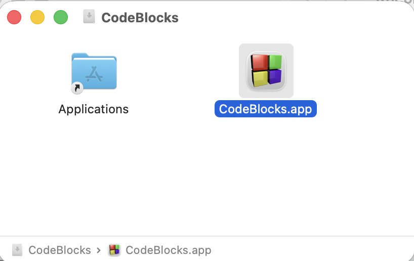
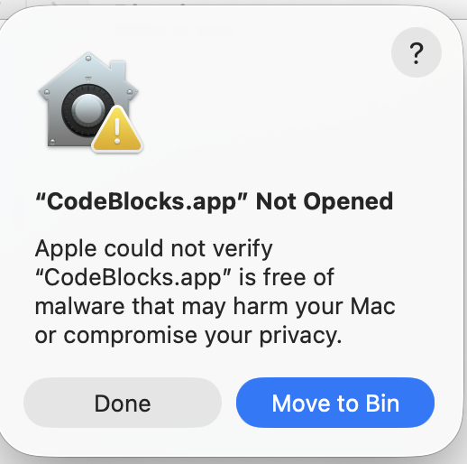
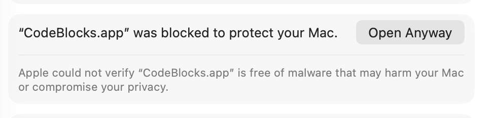

# Code::Blocks for macOS

This repository provides an unofficial native macOS build of Code::Blocks for Apple Silicon. It is based on Code::Blocks trunk revision 14050 and IDE version 25.03.

This project is for macOS only. Windows and Linux users should use the [official Code::Blocks website](https://www.codeblocks.org) and the original source repository:

```text
svn://svn.code.sf.net/p/codeblocks/code/trunk
```

The Code::Blocks IDE is licensed under GPL-3 (`COPYING`). The SDK is licensed under LGPL-3, as stated in the SDK source-file headers.

## Download and install

Download the desired `.dmg` from this repository's **Releases** section. Open it, then drag `CodeBlocks.app` onto the Applications link or copy it to another location.

The application runs natively on Apple Silicon and does not require Rosetta.



### First launch: Gatekeeper

The application is **not notarised** because this project does not use a paid Apple Developer Program membership. macOS therefore blocks the first launch of each downloaded copy. This is expected and does not mean the download is damaged.

1. Open `CodeBlocks.app`. When macOS displays the following dialog, click **Done**, not **Move to Bin**.

   

2. Open **System Settings → Privacy & Security**, scroll to the security section, and click **Open Anyway** beside the blocked-app notice.

   

3. Confirm the launch if macOS asks again.

Later launches should open normally. After replacing the application with a copy from a newer `.dmg`, you may need to repeat these steps once.

Gatekeeper approval only permits the application to open. If macOS later prevents the bundled GDB from attaching to a program, use the debugging repair described below.

## Using the debugger

Code::Blocks v1.2 and later include the matching Apple Silicon GDB and use it by default. No separate GDB installation or debugger-path configuration should normally be required.

If debugging fails because macOS does not allow the bundled GDB to attach, Code::Blocks offers **Enable debugging on this Mac**. The repair runs only after you agree and applies only to the bundled debugger.

- Choose **Enable debugging** to run the repair.
- Choose **Not now** to leave the system unchanged.
- Choose **Don't ask again** to disable future automatic offers.
- To restore automatic offers, open **Settings → Debugger → GDB/CDB debugger**.
- The manual command **Debug → Enable debugging on this Mac…** is shown when Code::Blocks has identified a repairable problem.

The repair may request administrator approval. Manual certificate and `codesign` procedures in [code_signing.md](code_signing.md) are intended only for advanced recovery.

An explicitly configured custom debugger remains untouched and takes precedence over the bundled default. To return to the bundled debugger, clear or update the executable path under:

```text
Settings > Debugger
```

The companion Apple Silicon GDB source is maintained in the [binutils-gdb repository](https://github.com/tbgitoo/binutils-gdb).

### Code::Blocks v1.0 and v1.1

These releases do not include GDB. Install the companion Apple Silicon GDB or another compatible GDB build, then configure its executable under **Settings → Debugger**.

## Working with a single source file

From v2.1, a saved C or C++ source file can be run or debugged without creating a project. With no project open:

1. Open a saved `.c`, `.cpp`, or similar source file.
2. Set breakpoints if needed.
3. Choose **Build**, **Build and Run**, **Debug**, or **Step Into**.

For debugging, Code::Blocks rebuilds the active file with debug information and starts GDB on the resulting executable. From v2.2, these commands follow the active source: an active standalone file uses the standalone workflow, while an active project file uses its project.

If a file was saved with the wrong extension, right-click its editor tab and choose **Rename…**. The file is renamed in place; project-owned files are also updated in the project tree.

### Standalone workflow limitations

Create a project when you need more control. The standalone workflow intentionally uses:

- one source file;
- the default compiler and compiler settings;
- no program arguments;
- the source directory as the working directory;
- console programs only.

Debug always rebuilds first. A failed compilation never starts GDB or falls back to an older executable. New or unsaved buffers must be saved before debugging.

### Watches and `std::string`

With the default Apple libc++ toolchain, the Watches pane shows a readable value for recognised `std::string` objects. Expand the row to inspect the underlying GDB representation. Unrecognised layouts retain the raw display.

## Console output

On macOS, console programs use the in-IDE **Program Console** by default. Select the mode under:

```text
Settings > Environment > Console programs
```

Available modes are:

- **Program Console (Logs & others)**: standard input and output remain inside Code::Blocks.
- **Terminal.app**: use an external Terminal window.

The Program Console supports ordinary UTF-8 console input and output, but it is not a complete ANSI/VT100 terminal emulator.

### Immediate output while debugging

The following option is enabled by default:

```text
Settings > Debugger > GDB/CDB debugger > Common
Show program output immediately while debugging (macOS)
```

It makes unflushed output appear while stepping when the companion GDB supports this capability. It affects **Debug** only; **Run** keeps normal buffering. Disable it if the program must retain line-buffered output.

## Build the application yourself

### Prerequisites

Install the required tools and wxWidgets using Homebrew:

```bash
brew install wxwidgets autoconf automake libtool pkg-config
```

### Build Code::Blocks

From the repository root:

```bash
./bootstrap
./configure --prefix="$(pwd)/_cb_install" --disable-fortran --disable-contrib-plugins CC=clang CXX=clang++
make -j"$(sysctl -n hw.ncpu)"
make install
./make_cb_app_bundle.sh
```

The staged installation is written to `_cb_install`, and `make_cb_app_bundle.sh` creates `CodeBlocks.app` from it. Quit any running copy before replacing an existing application bundle.

To create the release disk image after a successful application build:

```bash
./make_cb_dmg.sh
```

### Build with the bundled GDB

For v1.2 and later, place the companion GDB source tree beside this repository:

```text
parent-directory/
  codeblocks-macos/
  binutils-gdb/
```

Build and stage GDB under:

```text
../binutils-gdb/staging/
```

The application bundler requires at least:

```text
../binutils-gdb/staging/bin/gdb
../binutils-gdb/staging/share/gdb/
```

If GDB is staged elsewhere, set `CB_BUNDLE_GDB_PREFIX` before running `make_cb_app_bundle.sh`.

The bundler copies GDB, its support files, required redistributable libraries, and licence notices into `CodeBlocks.app`. It also applies the normal ad-hoc signature and debugger entitlement used by release builds:

```bash
./make_cb_app_bundle.sh
# Equivalent explicit mode:
./make_cb_app_bundle.sh --gdb-sign=normal
```

Unsigned and no-entitlement bundle modes exist for testing repair paths. See [code_signing.md](code_signing.md), and **never distribute those test builds**.

The bundled debugger is installed under:

```text
CodeBlocks.app/Contents/Resources/debugger/
  bin/gdb
  share/gdb/
  lib/
  licenses/
```

## Bootstrap troubleshooting

`./bootstrap` needs the wxWidgets Autoconf macros, including `wxwin.m4`. The script attempts to locate them through `wx-config`.

If it reports that `AM_OPTIONS_WXCONFIG` cannot be found, run:

```bash
ACLOCAL_FLAGS="-I $(wx-config --prefix)/share/wx/$(wx-config --release)/aclocal" ./bootstrap
```

Warnings about obsolete Autoconf macros are usually non-fatal. A missing `wxwin.m4` or `AM_OPTIONS_WXCONFIG` macro is the relevant error here.

## Existing Code::Blocks settings

Explicit user settings override the compiled defaults. An older configuration may therefore continue using a custom debugger executable or Terminal command.

To test the bundled defaults, clear the corresponding setting manually or start with a clean Code::Blocks configuration.

## Advanced technical notes

Detailed information about signing recovery, test modes, macOS debugger integration, Terminal handling, and implementation decisions is maintained in [code_signing.md](code_signing.md) and the repository's planning documents. The normal user path is intentionally limited to installing the application, approving its first launch, and accepting **Enable debugging on this Mac** only if Code::Blocks identifies a signing-related debugger failure.
